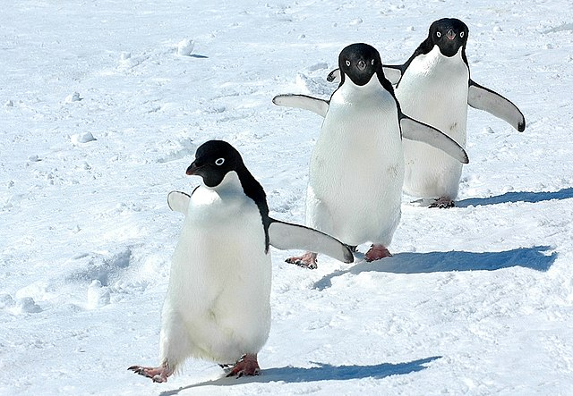
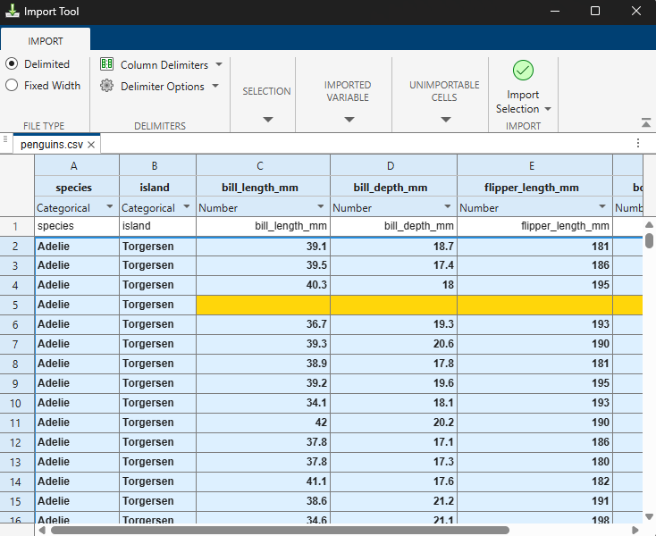
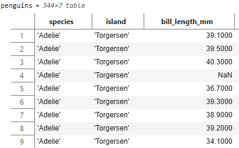
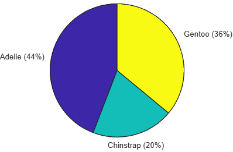
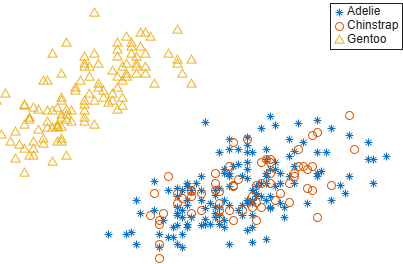
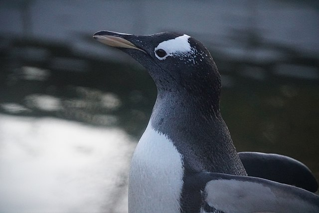
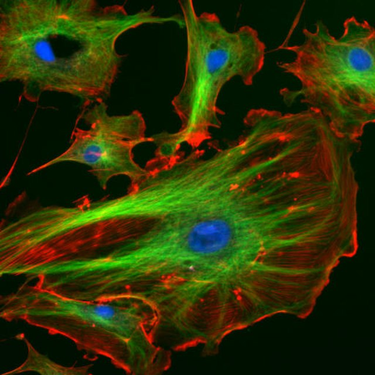
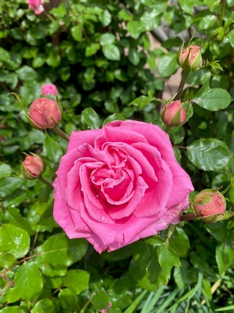
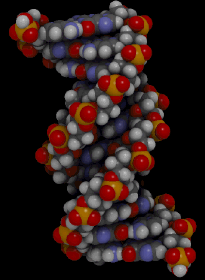

# Biosciences: Working with Data

This module uses the Palmer penguins dataset to introduce loading, exploring, and visualizing biological data in MATLAB.

 

**Curriculum Module**

_Created with R2025a. Compatible with R2025a and later releases._

For MATLAB R2024b or older, download the [legacy `.mlx` release](https://github.com/MathWorks-Teaching-Resources/Biosciences-Working-With-Data/releases/tag/mlx).

# Information

This curriculum module contains interactive [MATLAB® live scripts](https://www.mathworks.com/products/matlab/live-editor.html) that use biological data to teach fundamental concepts of statistics, data analysis, and data visualization. 

## Background

This courseware utilizes the [palmerpenguins](<https://allisonhorst.github.io/palmerpenguins/articles/intro.html#installation>) \[1\] dataset, which contains the measurements of the size of three different (and very cute!) penguin species that were found on three different islands in the Palmer Archipelago in Antarctica. These data were collected and [published](https://journals.plos.org/plosone/article?id=10.1371/journal.pone.0090081) by Dr. Kristen Gorman between 2007 and 2009 as part of the Palmer Station Long Term Ecological Research Program \[2\] (linked pages have more information on the [data](<https://github.com/allisonhorst/palmerpenguins#additional-data-use-information>) and [licensing](https://creativecommons.org/share-your-work/public-domain/cc0/)).

Adelie penguins waddling around Snow Hill Island, [Antarctica](https://commons.wikimedia.org/wiki/File:2007_Snow-Hill-Island_Luyten-De-Hauwere-Adelie-Penguin-16.jpg).

Biologists love to classify things, particularly organisms, into groups. We often do this based on the similarity of characteristics between organisms. You've probably seen the [internationally accepted system](https://www.ncbi.nlm.nih.gov/books/NBK21100/) for naming and classifying living things in a high school textbook. This system is based on a classification method introduced in 1758 by Carolus Linnaeus, commonly regarded as the "father" of modern taxonomy (what we name the branch of science concerned with classifying stuff). This classification method has many levels, but you only need two (genus and species) to uniquely identify an organism!

The [species](https://en.wikipedia.org/wiki/Species) is the fundamental unit of taxonomy and a species is composed of a group of organisms that breed naturally in the wild and produce offspring that can *also* reproduce. A [genus](https://en.wikipedia.org/wiki/Genus) is a group of closely related species. For example, a lion and a tiger are of the same genus but are different species (they do not naturally interbreed, though sometimes a 'liger' will be found in captivity as the result of breeding between the two. [Ligers](https://en.wikipedia.org/wiki/Liger) either have reduced fertility or are infertile). In the case of our penguins, we have three species: *Adelie*, *Chinstrap*, and *Gentoo* penguins, all of which belong to the genus *Pygoscelis*.

These penguin species differ in size, appearance, foraging habits, where they live, and even how different males and females present within the species (sexual dimorphism). Looking at and quantifying the differences between species can give biologists a lot of really useful information. For example, does penguin size depend on the environment that they've evolved within? Do changes in body mass overall seem to predict other changes in that species (so if one penguin species tends to be bigger than another, is there a change in their bill size or shape)? Answering these  questions can tell us a lot about what factors drove the evolution of each species, or allow us to create computer programs that can classify penguins in the wild as one species or another.

You can use these live scripts as demonstrations in lectures, class activities, or interactive assignments outside class. This module will teach students how to use statistical methods in MATLAB® to analyze ecologically relevant data. We will access, explore, clean, and visualize data. This module utilizes the Palmer penguins \[1\] dataset, which contains data about three different species of penguin in Antarctica.

The instructions inside the live scripts will guide you through the exercises and activities. Get started with each live script by running it one section at a time. To stop running the script or a section midway (for example, when an animation is in progress), use the  Stop button in the **RUN** section of the **Live Editor** tab in the MATLAB Toolstrip.

## Contact Us

Contact the [MathWorks Educator Content Development Team](mailto:onlineteaching@mathworks.com) if you would like to request assistance, provide feedback, or if you have a question.

## Prerequisites

This module assumes you're familiar with the basics of using MATLAB by going through the [MATLAB Onramp](https://matlabacademy.mathworks.com/details/matlab-onramp/gettingstarted) before continuing. We also recommend reviewing the [Biosciences: Working with Data](https://www.mathworks.com/matlabcentral/fileexchange/181586-biosciences-working-with-data) courseware.

## Getting Started

### Accessing the Module

Use MATLAB R2025a or newer for these plain-text live scripts. For MATLAB R2024b or older, download the [legacy `.mlx` release](https://github.com/MathWorks-Teaching-Resources/Biosciences-Working-With-Data/releases/tag/mlx).

### **On MATLAB® Online**™:

Use the  link to download the module. You will be prompted to log in or create a MathWorks account. The project will be loaded, and you will see an app with several navigation options to get you started.

### **On Desktop:**

Download or clone this repository. Open MATLAB, navigate to the folder containing these scripts and double\-click on [BiosciencesWorkingWithData.prj](<matlab: openProject("BiosciencesWorkingWithData.prj")>). It will add the appropriate files to your MATLAB path and open an app that asks you where you would like to start.

Ensure you have all the required products ([listed below](#H_E850B4FF)) installed. If you need to include a product, add it using the Add\-On Explorer. To install an add\-on, go to the **Home** tab and select   **Add-Ons** > **Get Add-Ons**. 

## Products

MATLAB® is used throughout. Tools from the Statistics and Machine Learning Toolbox™ are used frequently as well.

# Scripts

## [Accessing and importing the data](<matlab: edit Scripts/S1AccessData.m>)
||||
| :-- | :-- | :-- |
|     | **In this script, students will...**   $\bullet$  learn how to grab data from GITHUB® and how to interact with live scripts.    | **Academic disciplines**   $\bullet$ Biology     |

## [Explore `penguins`](<matlab: edit Scripts/S2ExploreData.m>)
||||
| :-- | :-- | :-- |
|     | **In this script, students will...**   $\bullet$  learn how to grab data from GITHUB® and how to interact with live scripts.    | **Academic disciplines**   $\bullet$ Biology     |

## [Visualize `penguins`](<matlab: edit Scripts/S3VisualizeData.m>)
||||
| :-- | :-- | :-- |
|     | **In this script, students will...**   $\bullet$  learn how to use MATLAB to understand their data (how much?  what is measured?).    | **Academic disciplines**   $\bullet$ Biology     |

## [Problem set](<matlab: edit Scripts/S4ProblemSet.m>)
||||
| :-- | :-- | :-- |
|     | **In this script, students will...**   $\bullet$ practice importing, exploring, and visualizing data    | **Academic disciplines**   $\bullet$ Biology     |

# License

The license for this module is available in the [LICENSE.md](https://github.com/MathWorks-Teaching-Resources/Biosciences-Working-With-Data/blob/release/LICENSE.md).

# Related Courseware Modules

| **Courseware**    |  | **Location**     |
| :-- | :-- | :-- |
| [Biosciences: Statistical Methods](https://www.mathworks.com/matlabcentral/fileexchange/163691-biosciences-statistical-methods)     |     | **Available on:**          [GitHub](https://github.com/MathWorks-Teaching-Resources/Biosciences-Statistical-Methods)      |
| [Biosciences: Image Processing](https://www.mathworks.com/matlabcentral/fileexchange/163701-biosciences-image-processing)     |     | **Available on:**          [GitHub](https://github.com/MathWorks-Teaching-Resources/Biosciences-Image-Processing)      |
| [Biosciences: Machine Learning](https://www.mathworks.com/matlabcentral/fileexchange/163696-machine-learning-for-biosciences)     |      | **Available on:**          [GitHub](https://github.com/MathWorks-Teaching-Resources/Biosciences-Machine-Learning)      |
| [Biosciences: Genetics](https://www.mathworks.com/matlabcentral/fileexchange/163706-biosciences-genetics)     |      | **Available on:**          [GitHub](https://github.com/MathWorks-Teaching-Resources/Biosciences-Genetics)      |

Or feel free to explore our other [modular courseware content](https://www.mathworks.com/matlabcentral/fileexchange/?q=tag%3A%22courseware+module%22&sort=downloads_desc_30d).

# Educator Resources
- [Educator Page](https://www.mathworks.com/academia/educators.html)
- [Instructor Resources](InstructorResources/Documentation/README.md)

# Contribute 

Looking for more? Find an issue? Have a suggestion? Please contact the [MathWorks Educator Content Development Team](mailto:onlineteaching@mathworks.com). If you want to contribute directly to this project, you can find information about how to do so in the [CONTRIBUTING.md](CONTRIBUTING.md) page.

# Citations

\[1\] Horst AM, Hill AP, Gorman KB (2020). palmerpenguins: Palmer Archipelago (Antarctica) penguin data. R package version 0.1.0. [https://allisonhorst.github.io/palmerpenguins/](https://allisonhorst.github.io/palmerpenguins/) .

\[2\] Gorman KB, Williams TD, Fraser WR (2014). Ecological sexual dimorphism and environmental variability within a community of Antarctic penguins (genus *Pygoscelis*). PLoS ONE 9(3):e90081. [https://doi.org/10.1371/journal.pone.0090081](https://doi.org/10.1371/journal.pone.0090081)

*©* Copyright 2026 The MathWorks, Inc
